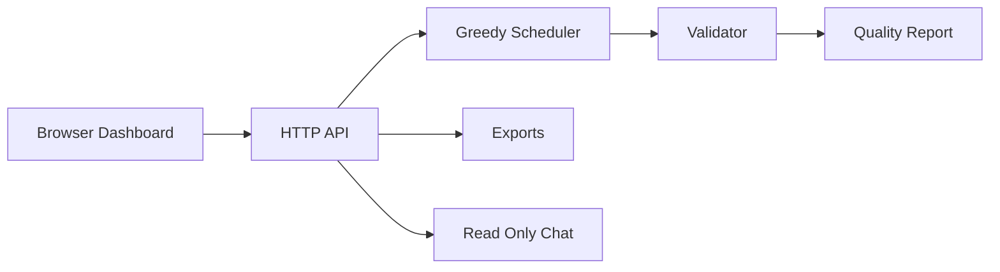

# Chronos University Timetable Generator

## Project Report

**Submitted by:** ____________________  
**Branch:** B.Tech Computer Science and Engineering  
**Guide:** ____________________  
**Academic year:** 2026

## Abstract

Preparing a university timetable manually is difficult because classrooms, instructors, student groups and laboratories are shared resources. A small change can create many clashes. Chronos is a web-based timetable generator developed as a final-year B.Tech prototype. It accepts course requirements, rooms, faculty availability and cohort details, generates a weekly timetable, and validates the result against hard rules. The project also provides timetable quality indicators, a teacher-absence what-if flow, CSV and iCalendar export, and a read-only chat helper for timetable questions. The design separates generation from validation: a schedule is displayed as feasible only after all implemented hard constraints pass. The project uses a deterministic greedy scheduling algorithm so its decisions can be explained clearly during a viva.

## 1 Introduction

University timetabling is a constraint satisfaction problem. Each class must get the required number of weekly hours, but no room, teacher or cohort can be in two places at once. Laboratories need continuous periods, room capacities must be sufficient, and teachers may have unavailable periods. Manual spreadsheet-based preparation is time-consuming and error-prone. The goal of Chronos is to automate the repetitive part while keeping the project simple, transparent and practical for a department-level deployment.

## 2 Problem Statement

Develop a web application that prepares a weekly timetable for a university department. The system must allocate every course meeting to a valid day, period and room while avoiding resource conflicts. It should check the output, report quality measurements, allow basic scenario analysis and answer common timetable questions.

## 3 Objectives

1. Generate a weekly timetable from structured course, room and faculty data.
2. Prevent cohort, faculty and room clashes.
3. Enforce room type, capacity, faculty availability, maximum weekly load and lunch-break rules.
4. Support continuous practical sessions.
5. Calculate understandable quality indicators.
6. Provide CSV and iCalendar exports.
7. Provide a safe, read-only timetable chat helper.

## 4 Scope

The current prototype supports one department using bundled synthetic data. It includes lecture, classroom and laboratory requirements, fixed Monday-Friday time slots and one lunch break. It is not a full ERP product. User login, database persistence, drag-and-drop editing, mobile deployment and integration with university records are future improvements.

## 5 Requirement Analysis

### Functional Requirements

| ID | Requirement |
|---|---|
| FR1 | Load courses, rooms, instructors and meeting requirements. |
| FR2 | Generate a timetable deterministically. |
| FR3 | Validate the generated entries before reporting success. |
| FR4 | Show course, cohort, day, period and room in a browser table. |
| FR5 | Export the current schedule as CSV and iCalendar. |
| FR6 | Simulate a teacher absence without changing the original schedule. |
| FR7 | Answer supported timetable questions through chat. |

### Non Functional Requirements

The project should be simple to run, deterministic for the same input, understandable in a viva, and safe by design. The chat must not edit timetable data. The prototype uses only the Python standard library, so it can run without downloading packages.

## 6 System Design

The browser dashboard communicates with a small Python HTTP server. The server loads the demo dataset and sends it to the scheduling engine. The engine tries valid slots and rooms in a fixed order, placing more constrained requirements first. The validator independently checks the completed timetable. The analytics service computes quality values and the chatbot reads the generated schedule only.

## 7 Data Model

The main entities are Room, Instructor, Meeting Requirement and Timetable Entry. A meeting requirement contains a course name, cohort, teacher, number of students, weekly hours, block size and required room type. A timetable entry stores the selected room, day, period and duration.

## 8 Algorithm

Chronos uses a deterministic first-fit greedy heuristic.

1. Sort requirements so scarce room types and longer lab blocks are handled first.
2. For each required meeting, inspect weekday and period combinations in a fixed order.
3. Select the first room whose type and capacity match.
4. Reject a candidate if it overlaps an existing room, cohort or teacher entry, violates availability, crosses lunch, or exceeds weekly workload.
5. Add accepted entries to the schedule.
6. Run the complete validator after all requirements have been processed.

The algorithm is easy to explain. Its disadvantage is that it may not find a solution for every feasible large instance. A future version can replace only the scheduler with OR-Tools CP-SAT while retaining the same validator.

## 9 Constraints Implemented

| Code | Constraint |
|---|---|
| H1 | Each requirement receives the requested weekly hours and block length. |
| H2 | A cohort cannot attend overlapping meetings. |
| H3 | An instructor cannot teach overlapping meetings. |
| H4 | A room cannot host overlapping meetings. |
| H5 | The room type and accessibility must match the requirement. |
| H6 | Room capacity must be sufficient. |
| H7 | A lab block must not cross the lunch break. |
| H8 | Entries must be in the time grid and respect teacher unavailability. |
| H9 | Instructor maximum weekly teaching hours must not be exceeded. |

## 10 Modules

### Timetable Generator

The generator accepts the synthetic CSE department scenario. It handles lectures, classrooms and computer laboratory sessions. The resulting table is shown after a FEASIBLE status is returned.

### Validator

The validator is the safety boundary. It indexes occupied periods for each room, instructor and cohort. Any double booking produces a labelled error such as H2, H3 or H4. It also checks total requirement hours and room suitability.

### Quality Report

The dashboard displays hard-violation count, student/cohort gaps, early periods, number of rooms used, a simple green score, teacher-load fairness using a Gini-style value, resilience score and total penalty. These are indicators for comparing alternatives; they do not replace hard constraints.

### What If Teacher Absence

The user can click the absence button for Dr Sharma. The application keeps unaffected entries and attempts to regenerate only affected requirements. This illustrates minimal-disruption rescheduling.

### Timetable Help Chat

The chatbot is not generative AI. It is a small rule-based question-answer interface over the current generated timetable. It handles course location, cohort timetable, teacher schedule and room-use queries. It displays help examples when it cannot recognise a query. Importantly, it never calls an outside service, writes to a timetable, or bypasses validation.

## 11 User Interface

The dashboard contains a Generate Timetable button, export buttons, absence simulation, quality cards, a timetable grid and a Timetable Help Chat box. A suitable live demonstration is to generate the schedule, click Explain on one row, ask where a course is held, export CSV, and finally simulate absence.

## 12 Testing

The project has four automated unit tests.

| Test | Result |
|---|---|
| Demo data generates a feasible timetable | Pass |
| Validator detects a room conflict | Pass |
| Quality report returns hard-violation and resilience values | Pass |
| Chat answers a course-location question | Pass |

Run tests using `python -m unittest discover -s backend/tests -v`. The test run completed with four tests passing.

## 13 Results

The bundled example schedules six requirements, including lectures and two-hour labs. It produces zero hard-constraint violations under the implemented rules. The metrics displayed by the dashboard change automatically with the schedule. The exact indicators are generated at runtime rather than hard-coded in the report.

## 14 Limitations

The dataset is synthetic and small. The heuristic is not guaranteed to find a solution even if one exists. There is no database, authentication, individual student enrolment conflict graph or visual drag-and-drop editor. The availability chatbot recognises supported phrase patterns rather than unrestricted language. These limitations are stated honestly so the project can be improved phase by phase.

## 15 Future Enhancements

Replace the greedy scheduler with OR-Tools CP-SAT, add PostgreSQL storage and login roles, support student-level elective conflict detection, add drag-and-drop editing with live validation, add PDF/Excel export, and connect the chat helper to a controlled natural-language layer while keeping it read-only.

## 16 Conclusion

Chronos demonstrates that timetable generation can be automated with transparent programming techniques. Its key contribution is the separation of generation and validation: a timetable is not accepted merely because an algorithm created it. The project is practical, easy to run and suitable for explaining core scheduling concepts in a final-year project demonstration.

## 17 Six Minute Demo Script

1. Introduce the problem: shared teachers, rooms and labs make manual scheduling difficult.
2. Explain the entities: requirement, instructor, cohort, room and entry.
3. Click Generate Timetable and show the FEASIBLE result.
4. Open the timetable table and click Explain on Data Structures.
5. Point out the quality cards and explain that hard violations must remain zero.
6. Ask the chat: “where is Data Structures?” and “Dr Sharma schedule”.
7. Export CSV or iCalendar.
8. Click the teacher absence simulation and explain minimal disruption.
9. State the future upgrade: CP-SAT can replace the heuristic without changing the validator.

## 18 Viva Questions and Short Answers

**Why is timetabling hard?** Many constraints interact. A choice of one room or period can block another course, so the search space grows quickly.

**Why use a separate validator?** Generation code can have bugs or future manual edits may introduce conflicts. A separate validator is an independent safety check.

**What is a hard constraint?** A rule that cannot be broken, such as teacher overlap or insufficient room capacity.

**What is a soft constraint?** A preference, such as fewer timetable gaps or fewer early classes. It improves quality but does not decide validity.

**Why is the algorithm deterministic?** The same data produces the same output, which makes testing and demonstration easier.

**Why not use only a chatbot?** A chat system cannot reliably guarantee no double bookings. The scheduling engine and validator perform the actual rule checking.

**Can the chatbot modify the timetable?** No. It is read-only by design and only answers using the generated schedule.

**What is a greedy algorithm?** It makes the best immediate valid choice, here the first valid room and slot, instead of exploring every future combination.

**What is the main limitation of greedy scheduling?** It can get stuck even when another sequence of choices could produce a valid timetable.

**How would you improve it?** Use a CP-SAT solver for deeper search, add persistent data storage, and add more constraints incrementally with tests.
